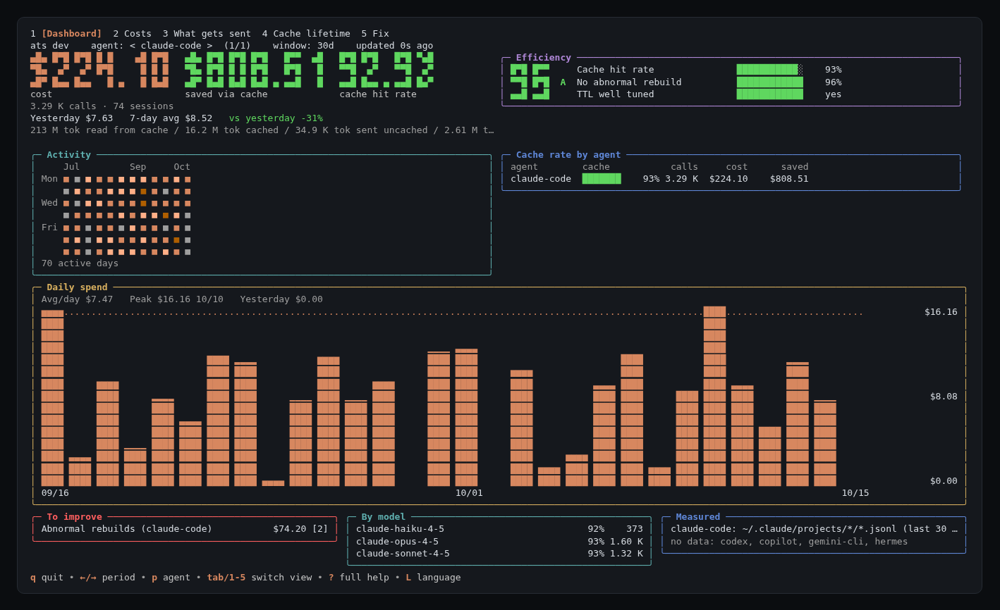

<p align="center">
  
</p>

<p align="center">
  <b>Voir où le cache de ton agent de code IA fait économiser, où il fuit, et quoi changer.</b><br>
  <code>ats</code> est un binaire hors ligne qui lit les journaux locaux de tes agents. Avec les méthodes et les mesures derrière.
</p>

<p align="center">
  <a href="LICENSE"></a>
  
  
  
</p>

<p align="center"><a href="README.md">English</a> | Français</p>

> Les pages de détail ([`docs/`](docs/)) et [`SETUP.md`](SETUP.md) sont en anglais.

## `ats` en une minute

```sh
go install github.com/thumeau-lab/agent-token-savings/cli/cmd/ats@latest
ats
```

Les binaires précompilés (macOS, Linux, Windows, amd64 et arm64) sont sur la
[page des releases](https://github.com/thumeau-lab/agent-token-savings/releases) ; `install.sh`
récupère le bon, vérifie son SHA256 et le pose dans `~/.local/bin` :

```sh
curl -fsSL https://raw.githubusercontent.com/thumeau-lab/agent-token-savings/main/install.sh | sh
```

`ats` sans argument ouvre un tableau de bord plein écran. Il détecte les agents installés et lit
leurs journaux de session locaux. Rien ne sort de ta machine : pas de compte, pas de clé API,
pas de réseau à l'exécution.

| Agent | Ce que lit `ats` |
|---|---|
| Claude Code | `~/.claude/projects/*/*.jsonl` |
| Codex CLI | `$CODEX_HOME/sessions` (par défaut `~/.codex`) |
| GitHub Copilot CLI | `~/.copilot/session-store.db`, en lecture seule |
| Hermes Agent | `~/.hermes/state.db` et ses profils |

### Ce qu'on voit

Cinq onglets, `1` à `5` ou `tab` pour passer de l'un à l'autre :

1. **Tableau de bord.** Ce que tu as dépensé, ce que le cache t'a fait économiser, ton taux de
   cache, en gros chiffres. Dessous : hier, la moyenne sur 7 jours et l'écart avec hier. Autour :
   un score d'efficacité sur 100 avec une lettre, une carte d'activité, les dépenses par jour, le
   taux de cache par agent et par modèle, une liste **À améliorer** classée par coût, et un cadre
   **Mesuré** qui dit de quels fichiers vient chaque chiffre et ce qu'`ats` n'a pas pu mesurer.
2. **Coûts.** Lectures et écritures de cache, entrée et sortie par agent, et les reconstructions
   anormales : les appels où tout le prompt a été réécrit.
3. **Contenu envoyé.** Ce qui remplit le début du prompt (prompt système, schémas d'outils,
   skills) et se repaie à chaque appel.
4. **Durée du cache.** Si la durée de vie du cache colle à ta façon de travailler : longue pour
   un humain qui répond lentement, courte pour les sous-agents et les crons.
5. **Corriger.** Les réglages à changer, sous forme de diff. Rien n'est écrit sans ta
   confirmation, et une copie `.bak` horodatée est gardée. `ats` ne propose jamais de couper le
   cache.

Les flèches gauche et droite changent la période, `p` l'agent, `L` la langue (français, anglais), `?` explique chaque
chiffre, y compris la formule du score d'efficacité.

### Dans un script

```text
ats cache  [agent] [--days N] [--json]   taux de cache, lectures, écritures, reconstructions
ats prefix [agent] [--json]              de quoi est fait le début du prompt
ats ttl    [agent] [--days N] [--json]   la durée du cache colle-t-elle à tes sessions
ats fix    [--write]                     montre la correction, l'applique avec --write
```

Redirigé ou avec `--no-tui`, `ats` sort du texte simple ; `--json` est stable et toujours en
anglais. `NO_COLOR` est respecté, `--lang fr` ou `ATS_LANG=fr` change la langue.

Les montants sont au tarif API public. Sur abonnement, ils mesurent la part de quota consommée,
pas de l'argent payé. Quand `ats` ne connaît pas le prix d'un modèle (Codex, Copilot), il le dit
au lieu de deviner. Pour la dépense globale tous fournisseurs confondus, voir
[CodeBurn](https://github.com/getagentseal/codeburn) ; `ats` ne regarde que le cache.

## Pourquoi ton agent brûle des tokens

Un agent renvoie **toute la conversation** au modèle à chaque message. On croit payer ce que
le modèle écrit ; on paie surtout ce qu'il relit, et encore plus ce qu'il doit réécrire
quand son cache casse. Sur 21 jours chez nous, la réponse du modèle pesait 9 % de la note,
la réécriture du cache 71 %.

Trois idées couvrent l'essentiel du gain, quels que soient l'outil et le modèle :

1. **Ne pas casser le cache** : le début du prompt ne doit jamais bouger.
2. **Raccourcir les sessions** : une session par sujet, compaction plus tôt.
3. **Charger moins au départ** : chaque outil, skill ou serveur MCP chargé se repaie à chaque message.

Tu veux que ton agent les applique pour toi ? Colle-lui ce message. Il mesure, propose chaque
changement avant de l'écrire, puis te donne l'avant / après :

```text
Lis https://raw.githubusercontent.com/thumeau-lab/agent-token-savings/main/SETUP.md et applique-le à mon installation.
```

## Comment marche le cache

Tous les grands fournisseurs (Anthropic, OpenAI, Google, DeepSeek...) mettent en cache le
**début** du prompt. À chaque tour, la partie déjà vue est relue en cache pour une fraction du
prix (vert) ; seule la fin est écrite (orange). Un octet qui change en tête, et tout est réécrit.

<p align="center"><picture><source media="(prefers-color-scheme: dark)" srcset="docs/img/cache-timeline-dark.svg"></picture></p>

<p align="center"><picture><source media="(prefers-color-scheme: dark)" srcset="docs/img/prompt-order-dark.svg"></picture></p>

Les règles varient selon le fournisseur (activation, durée de vie, surcoût d'écriture, taille
minimale) : voir [`docs/providers.md`](docs/providers.md).

## Les méthodes

<p align="center"><picture><source media="(prefers-color-scheme: dark)" srcset="docs/img/hero-dark.svg"></picture></p>

| Méthode | Comment | Gain mesuré |
|---|---|---|
| Préfixe figé | rien d'horodaté ni d'aléatoire en tête du prompt ; ne pas changer de modèle, d'effort de raisonnement ou de serveurs MCP en cours de session | la réécriture du cache faisait 71 % de la note |
| Durée de cache adaptée | TTL long quand un humain répond lentement, court pour sous-agents et crons | -18,7 % d'écriture sur une machine à crons |
| Sessions courtes | une session par sujet, compaction vers 150k tokens au lieu de la moitié de la fenêtre | -58 % de contexte relu par appel (un agent, corrélation) |
| Moins d'outils chargés | couper serveurs MCP, skills et outils inutilisables sur la machine | les schémas d'outils faisaient 68 % du préfixe d'un agent |
| Petit modèle pour le travail simple | sous-agents, résumés et titres sur un modèle léger | prix par token (doc fournisseur) |
| Sortie shell, verbosité | filtres de sortie comme [RTK](https://github.com/rtk-ai/rtk), réponses courtes | -43 à -61 % d'octets sur `git`, mais poste mineur |

## Les commandes par outil

| Outil | Nouvelle session | Compacter | Voir ce qui remplit le contexte | Cache |
|---|---|---|---|---|
| Claude Code | `/clear` | `/compact <focus>` | `/context`, `/mcp` | automatique |
| Codex CLI | `/new` | `/compact` | `/status`, `/mcp` | automatique (OpenAI) |
| Gemini CLI | `/clear` | `/compress` | `/stats`, `/memory list`, `/mcp` | implicite (Gemini 2.5+) |
| OpenCode | `/new` | `/compact` | | selon le fournisseur |
| Aider | `/clear` | | `/tokens` | `--cache-prompts`, `--cache-keepalive-pings N` |
| Cursor | nouveau chat | | | côté fournisseur |
| Hermes Agent | `/new` | `compression.threshold_tokens` | `hermes prompt-size` | `prompt_caching.cache_ttl` |
| Ton propre code | | | `usage` dans chaque réponse | voir [`providers.md`](docs/providers.md) |

Détail, sources et niveau de preuve de chaque levier : [`docs/levers.md`](docs/levers.md). Tous
nos chiffres : [`docs/measurements.md`](docs/measurements.md).

## Sans `ats`

Python 3, bibliothèque standard seule. Les scripts ne font que lire ; les chemins par défaut
sont ceux d'une installation standard.

```
npx ccusage daily
python3 tools/claude_cache_ratio.py
python3 tools/hermes_usage.py --days 14
```

Regarde les tokens **relus et écrits par appel**, pas seulement le taux de cache : il reste
autour de 90 % même quand la note est salée. Pour trouver le bloc qui casse le cache,
`tools/cache_diff.py` capture deux requêtes via un proxy local et nomme le premier bloc qui
diffère (clients compatibles Anthropic). Plus dans
[`docs/measurements.md`](docs/measurements.md#reproduce).

## Compiler depuis les sources

```sh
git clone https://github.com/thumeau-lab/agent-token-savings
cd agent-token-savings/cli
go test ./...
go build -o ats ./cmd/ats
```

## Limites

Un seul utilisateur, nos machines, surtout des modèles Anthropic. Avant / après en corrélation,
pas en expérience contrôlée. Les méthodes sont générales, tes chiffres seront différents : c'est
pour ça qu'`ats` et les scripts sont là. La capture en haut utilise des données factices.

## Licence

MIT, voir [`LICENSE`](LICENSE).
