<p align="center">
  <picture><source media="(prefers-color-scheme: dark)" srcset="docs/img/hero-dark.svg"></picture>
</p>

<p align="center">
  <b>Spend less on any AI coding agent. Same work, fewer tokens.</b><br>
  Methods that hold on every provider, numbers measured on real machines, scripts to measure your own setup.
</p>

<p align="center">
  <a href="LICENSE"></a>
  
  
</p>

<p align="center">English | <a href="README.fr.md">Français</a></p>

## 30-second setup

Paste this into your coding agent. It measures your usage, proposes each change before making
it, then shows you the before / after.

```text
Read https://raw.githubusercontent.com/thumeau-lab/agent-token-savings/main/SETUP.md and apply it to my setup.
```

[`SETUP.md`](SETUP.md) is written for an LLM: it detects your agent and provider, measures,
applies the levers in order of impact, and lists what never to do.

## Why your agent burns tokens

An agent sends **the whole conversation** back to the model on every message. You think you
pay for what the model writes; you mostly pay for what it re-reads, and even more for what it
has to re-write when its cache breaks. Over 21 days on our setup, the model's answers were
9% of the bill. Cache writes were 71%.

Three ideas cover most of the savings, whatever the tool or the model:

1. **Don't break the cache.** The start of the prompt must never change.
2. **Keep sessions short.** One session per task, compact earlier.
3. **Load less up front.** Every tool, skill or MCP server loaded is paid again on every message.

## How the cache works

Every major provider (Anthropic, OpenAI, Google, DeepSeek...) caches the **start** of the
prompt. Each turn, the part already seen is re-read from cache for a fraction of the price
(green); only the new tail is written (orange). Change one byte near the start, and everything
is written again.

<p align="center"><picture><source media="(prefers-color-scheme: dark)" srcset="docs/img/cache-timeline-dark.svg"></picture></p>

<p align="center"><picture><source media="(prefers-color-scheme: dark)" srcset="docs/img/prompt-order-dark.svg"></picture></p>

Rules differ per provider (opt-in, lifetime, write premium, minimum size): see
[`docs/providers.md`](docs/providers.md).


## The methods

| Method | How | Measured gain |
|---|---|---|
| Stable prefix | nothing timestamped or random at the start of the prompt; don't switch model, reasoning effort or MCP servers mid-session | cache writes were 71% of the bill |
| Cache lifetime that fits | long TTL when a human replies slowly, short for sub-agents and crons | -18.7% writes on a cron-heavy machine |
| Short sessions | new session per task, compaction at ~150k tokens instead of half the window | -58% context re-read per call (one agent, correlation) |
| Fewer tools loaded | turn off MCP servers, skills and tools you can't use on this machine | tool schemas were 68% of one agent's prefix |
| Cheaper model for small work | sub-agents, summaries and titles on a small model | per-token price (provider docs) |
| Shell output, verbosity | output filters such as [RTK](https://github.com/rtk-ai/rtk), shorter answers | -43 to -61% bytes on `git`, but a minor item |

## Commands per tool

| Tool | New session | Compact | See what fills the context | Cache |
|---|---|---|---|---|
| Claude Code | `/clear` | `/compact <focus>` | `/context`, `/mcp` | automatic |
| Codex CLI | `/new` | `/compact` | `/status`, `/mcp` | automatic (OpenAI) |
| Gemini CLI | `/clear` | `/compress` | `/stats`, `/memory list`, `/mcp` | implicit (Gemini 2.5+) |
| OpenCode | `/new` | `/compact` | | depends on provider |
| Aider | `/clear` | | `/tokens` | `--cache-prompts`, `--cache-keepalive-pings N` |
| Cursor | new chat | | | provider side |
| Hermes Agent | `/new` | `compression.threshold_tokens` | `hermes prompt-size` | `prompt_caching.cache_ttl` |
| Your own code | | | `usage` in each response | see [`providers.md`](docs/providers.md) |

Details, sources and evidence level of each lever: [`docs/levers.md`](docs/levers.md). All our
numbers: [`docs/measurements.md`](docs/measurements.md).

## Measure it yourself

Python 3, standard library only. The scripts only read; default paths are those of a standard
install.

```
npx ccusage daily
python3 tools/claude_cache_ratio.py
python3 tools/hermes_usage.py --days 14
```

[`ccusage`](https://github.com/ccusage/ccusage) reads the local logs of the main coding CLIs.
With your own code, read the usage fields listed in [`providers.md`](docs/providers.md). Watch
tokens **re-read and written per call**, not the cache hit rate: it stays around 90% even when
the bill is high. To find which part of the prompt breaks the cache, `tools/cache_diff.py`
captures two requests through a local proxy and names the first block that differs
(Anthropic-compatible clients). More in [`docs/measurements.md`](docs/measurements.md#reproduce).

## Limits

One user, our machines, mostly Anthropic models. Before / after is a correlation, not a
controlled experiment. Dollar amounts use public API prices; on a subscription they measure
the share of quota used. The methods are general; your numbers will differ, which is why the
scripts are here.

## License

MIT, see [`LICENSE`](LICENSE).
