# Measurements (case study)

This is a case study of one setup (one user, Anthropic models via Claude Code and Hermes Agent), measured on 2026-10-11; the methods apply to any agent, the numbers are ours. Each line comes from a script in the repo, raw outputs in [`results/`](../results/). Back to the [README](../README.md).

## How the cache works

An agent resends the whole conversation on every call. The prefix already seen gets re-read
from cache for almost nothing; as soon as one byte changes upstream (tool added, timestamp,
compaction, TTL expired), everything after it gets rewritten.

<p align="center"><picture><source media="(prefers-color-scheme: dark)" srcset="img/cache-timeline-dark.svg"></picture></p>

| Opus 5.5, per M tokens ([doc](https://platform.claude.com/docs/en/build-with-claude/prompt-caching#pricing)) | Input | 5 min write | 1 h write | Read | Output |
|---|---:|---:|---:|---:|---:|
| | $4 | $5 | $8 | $0.20 | $20 |

A 1 h write costs **40 reads**. Result over 21 days of Hermes:

<p align="center"><picture><source media="(prefers-color-scheme: dark)" srcset="img/flip-dark.svg"></picture></p>

| | Tokens | Token share | API equivalent | $ share |
|---|---:|---:|---:|---:|
| Cache read | 1.54 G | 91% | $309 | 20% |
| Cache write | 137 M | 8% | $1,097 | **71%** |
| Output | 6.8 M | 0.4% | $136 | 9% |

Shortening replies touches 9% of the bill; preventing rewrites touches 71%.
Cross-checked against `npx ccusage hermes daily` to within 1%.

## What we measured

**Our usage, 30 days** (breakdown by profile and model: [`results/usage_inventory.md`](../results/usage_inventory.md))

| Machine | Agent | API equivalent | Written to cache | Cache hit |
|---|---|---:|---:|---:|
| Server A | Hermes (3 profiles: main assistant, two specialized agents) | $1,338 | 143 M | 92% |
| Laptop | Claude Code | $703 | 11.6 M | 99% |
| Server B | Hermes (one chat-bot profile) | $236 | 32.8 M | 92% |
| Laptop | Codex | marginal | | 94% |

Hermes writes 12x more than Claude Code for a comparable volume re-read. Subagents
rewrite 18% of what they re-read, twice as much as main sessions: a
short session pays for its prefix without amortizing it.

**Claude Code, one lever at a time** ([`bench/claude_code_levers.py`](../bench/claude_code_levers.py),
2 `claude -p` calls per variant, v2.1.220, Haiku, no MCP)

<p align="center"><picture><source media="(prefers-color-scheme: dark)" srcset="img/claude-code-prefix-dark.svg"></picture></p>

| Variant | Prefix | Warm call | Rewritten warm |
|---|---:|---:|---:|
| default | 28,362 | $0.0158 | 6,566 |
| `DISABLE_PROMPT_CACHING=1` | 28,362 | $0.0288 | all paid full price |
| `--setting-sources project` | 24,311 | $0.0032 | 0 |
| `--disable-slash-commands` | 25,741 | $0.0031 | 0 |
| `--tools ""` | **9,072** | **$0.0019** | 0 |

- A warm call costs 9x less than a call without cache: cutting the cache gains nothing.
- Tool schemas make up 68% of the prefix: every tool or MCP added gets paid for every turn.
- **The 6.5k rewritten warm have a cause**: [`tools/cache_diff.py`](../tools/cache_diff.py)
  captures two real requests and compares them. Same blocks, different order: the plugins'
  `SessionStart` hooks (two output-style plugins) inject themselves in a non-deterministic order
  ([`results/cache_diff_claude_code.txt`](../results/cache_diff_claude_code.txt)).

**Hermes before/after the 2026-10-03 tuning** (`tools/hermes_usage.py --split 2026-10-03`)

| Period | Calls | Re-read / call | Written / call | Hit |
|---|---:|---:|---:|---:|
| 2026-09-21 to 2026-10-02 | 3,329 | 241,521 | 21,018 | 92.0% |
| 2026-10-03 to 2026-10-11 | 7,290 | **101,552 (-58%)** | **9,206 (-56%)** | 91.7% |

The hit rate does not move and says nothing about cost; the useful metric is volume **per
call**. Correlation, not a controlled experiment.

<p align="center"><picture><source media="(prefers-color-scheme: dark)" srcset="img/rtk-dark.svg"></picture></p>

**RTK on shell output** ([`bench/rtk_bytes.py`](../bench/rtk_bytes.py), in bytes): -43%
on `git status`, -61% on `git log` and `ls -la`, 0% on `git diff --stat`, and `find` truncated
to the point the agent no longer sees the full list. Real gain on a minor item: a shell output
is written once then re-read at the lowest rate.

## Fixes applied on 2026-10-11

| Where | Problem | Fix | Effect |
|---|---|---|---|
| Output-style plugin (Hermes) | 5.2k characters reinjected on every message, kept in history | body sent once, short reminder after | 5,228 to 90 characters per turn |
| Hermes, servers A and B | `cache_ttl: 1h` for everything, including subagents and crons | `cache_ttl: auto`: 1 h for humans, 5 min for machine sessions | write: -1.5% on A, **-18.7% on B** ([`tools/ttl_auto_estimate.py`](../tools/ttl_auto_estimate.py)) |

## Reproduce

Python stdlib only, `pytest` for tests. No script writes to the databases it reads.
Default paths are those of a standard install (`~/.hermes`, `~/.claude`): on
your machine, the same commands give your own numbers.

```
python3 tools/hermes_usage.py --days 21 --split 2026-10-03 --json results/hermes_usage.json
python3 tools/claude_cache_ratio.py
python3 tools/ttl_auto_estimate.py ~/.hermes
python3 tools/cache_diff.py proxy /tmp/cap
python3 tools/cache_diff.py diff /tmp/cap/000.json /tmp/cap/001.json
python3 bench/rtk_bytes.py --json results/rtk_bytes.json
python3 bench/claude_code_levers.py --model haiku
python3 tools/make_charts.py
python3 -m pytest -q tests
```

The `cache_diff.py` proxy is used with `ANTHROPIC_BASE_URL=http://127.0.0.1:8977` and
only records request bodies: token and API key never touch disk. Only
`claude_code_levers.py` costs anything ($0.18 in Haiku). The charts are animated SVGs
in pure CSS, generated from `results/`, and respect `prefers-reduced-motion`.
